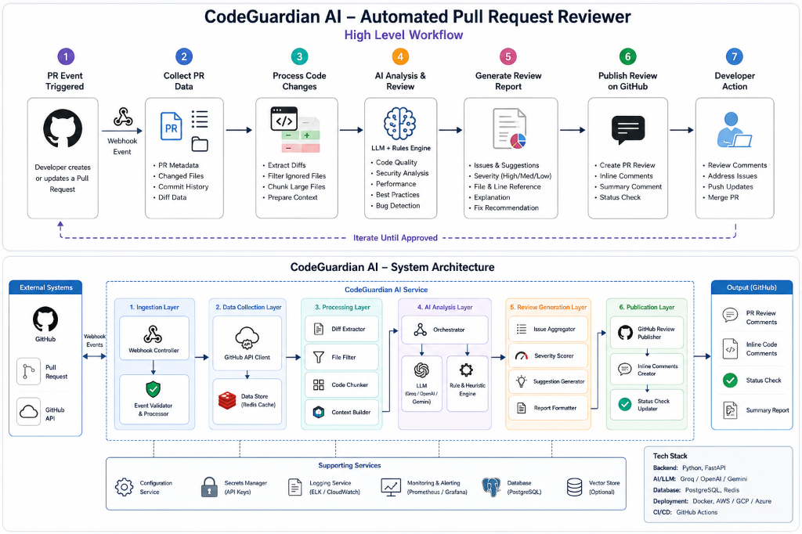
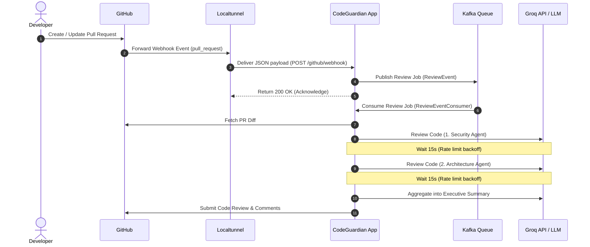
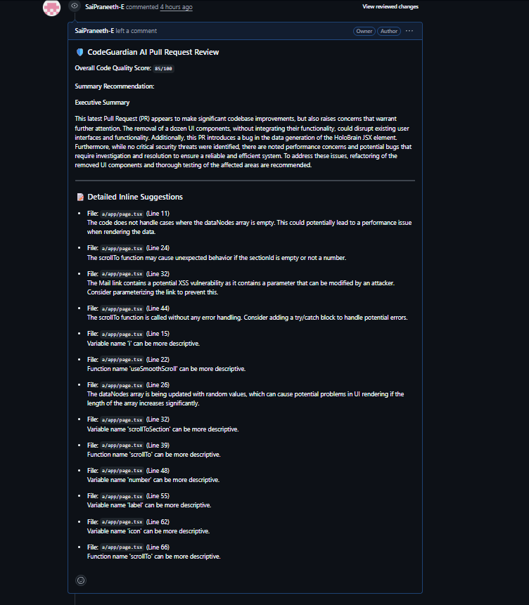
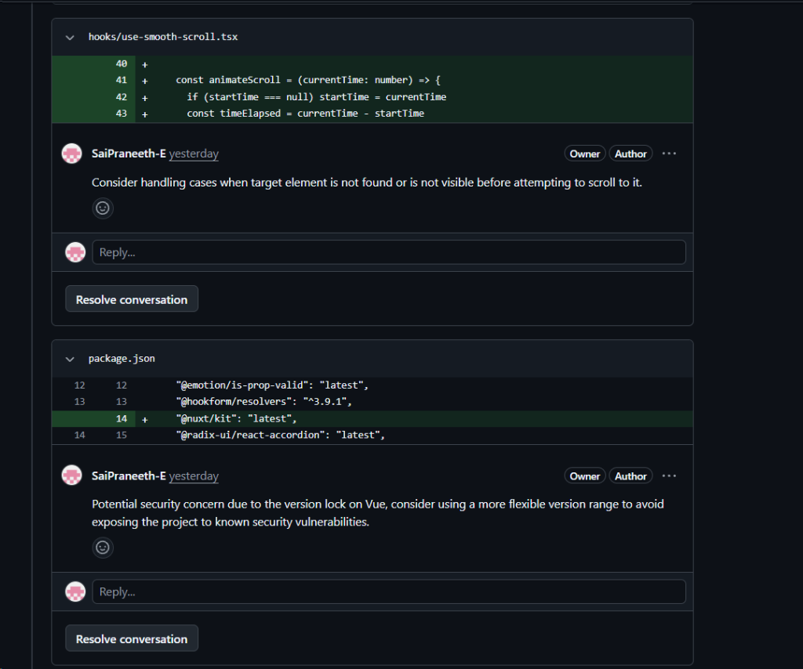
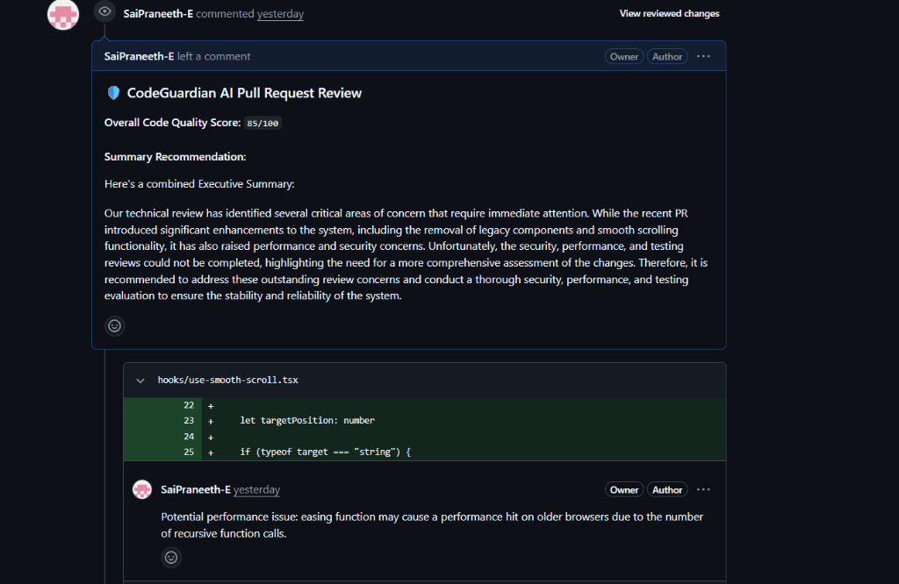

# 🛡️ CodeGuardian AI — Automated Pull Request Reviewer

[](https://github.com/likita-12/CodeGuardian-AI-Automated-Pull-Request-Reviewer)
[](https://openjdk.org/)
[](https://spring.io/projects/spring-boot)
[](https://react.dev/)
[](https://www.docker.com/)
[](https://opensource.org/licenses/MIT)

**CodeGuardian AI** is an intelligent, autonomous multi-agent code review system developed and maintained by **[Likita Reddy (likita-12)](https://github.com/likita-12)**. It listens to GitHub pull request webhooks in real-time, analyzes code diffs through specialized AI agents (Security and Architecture), and posts aggregated, high-fidelity reviews directly back to the GitHub PR.

---

## 📑 Table of Contents

- [Overview](#-overview)
- [Project Architecture & Stack](#-project-architecture--stack)
- [Workflow Pipeline](#-workflow-pipeline)
- [Self-Review & Format Fallbacks](#-self-review-and-format-fallbacks)
- [Quick Start Guide](#-quick-start-guide)
  - [1. Prerequisites](#1-prerequisites)
  - [2. Clone Repository](#2-clone-repository)
  - [3. Configure Environment Variables](#3-configure-environment-variables)
  - [4. Spin Up Services](#4-spin-up-services)
- [Connecting to GitHub Webhooks](#-connecting-to-a-github-repo-real-time-webhooks)
- [Ad-hoc Testing & Verification](#-ad-hoc-testing--verification)
- [CLI Commands Reference](#-commands-reference)
- [Review Results in Action](#-review-results-in-action)
- [Author & Maintainer](#-author--maintainer)
- [License](#-license)

---

## 🌟 Overview

CodeGuardian AI transforms code review automation by combining:
- **Real-Time Event Processing:** Subscribes to GitHub `pull_request` webhooks via Localtunnel or cloud endpoints.
- **Multi-Agent Evaluation:** Dispatches PR diffs through specialized Security and Architecture AI agents powered by Groq / Gemini LLMs.
- **Asynchronous Architecture:** Uses Apache Kafka for reliable, decoupled message brokering and token rate-limit backoff handling.
- **RAG & Vector Embeddings:** Leverages Qdrant vector database for codebase embedding and contextual retrieval.
- **Interactive Dashboard:** Modern React UI for tracking agent acceptance metrics, system health, and conversational AI reviews.

---

## 🏗️ Project Architecture & Stack

Below is the high-level system architecture and workflow diagram of the CodeGuardian AI service:



The system follows a clean, **Hexagonal (Ports & Adapters)** architectural pattern to isolate core business logic from databases, brokers, and external APIs:

```
                  ┌──────────────────────────────────────────────┐
                  │                  PORT & ADAPTERS             │
                  │                                              │
                  │  ┌──────────────┐       ┌──────────────┐     │
                  │  │  Inbound     │       │  Outbound    │     │
                  │  │  Adapters    │       │  Adapters    │     │
                  │  └──────┬───────┘       └──────▲───────┘     │
                  │         │                      │             │
                  │  ┌──────▼──────────────────────┴───────┐     │
                  │  │          Core Usecases              │     │
                  │  │  (Orchestrator, Multi-Agent Review) │     │
                  │  └──────────────┬──────────────────────┘     │
                  │                 │                            │
                  │          ┌──────▼──────┐                     │
                  │          │ Core Domain │                     │
                  │          └─────────────┘                     │
                  └──────────────────────────────────────────────┘
```

* **Core Domain:** Represents entities like `PullRequest`, `ReviewResult`, `AgentReport`, and `Comment`.
* **Use Cases:** Orchestrates the review flow, processes diffs, executes sequential multi-agent evaluations, and handles token/rate limit backoffs.
* **Inbound Adapters:** REST webhook controller (`GitHubWebhookController`) and REST APIs for feedback, indexing, and chat.
* **Outbound Adapters:** GitHub Client wrapper (`GitHubClientAdapter`), Qdrant Vector store adapter, and PostgreSQL persistence.

### Technical Stack
* **Backend:** Spring Boot (Java 21 / Maven)
* **Frontend:** React + Vite (Dashboard UI on port `3000`)
* **Message Broker:** Apache Kafka & Zookeeper (Ensures asynchronous, reliable processing of reviews)
* **Relational Storage:** PostgreSQL (Persists PR state, review logs, and audit logs)
* **Vector Store:** Qdrant (Indices codebase embeddings for semantic search/RAG)
* **Cache Store:** Redis
* **AI Engine:** Groq API (`llama-3.1-8b-instant`) or Gemini API

---

## 🔄 Workflow Pipeline

The end-to-end review lifecycle works as follows:



---

## 🛡️ Self-Review and Format Fallbacks

To handle GitHub API constraints, the system implements a multi-tier fallback mechanism:
1. **Initial Submission:** Attempts a structured inline review with specific line comments.
2. **Path Unresolved Fallback (422):** If the generated code references lines/files that GitHub cannot map in the current diff, the adapter catches the exception, collapses all comments into the markdown summary body, and retries.
3. **Self-Review Fallback (422):** If the repository owner created the PR, GitHub blocks automated reviews (`APPROVE` / `REQUEST_CHANGES`). The system catches this constraint and submits the report as a simple `COMMENT` review.

---

## 🚀 Quick Start Guide

### 1. Prerequisites
Ensure you have the following installed on your machine:
* [Git](https://git-scm.com/)
* [Docker & Docker Compose](https://www.docker.com/)
* PowerShell (for helper scripts on Windows)

### 2. Clone Repository
Clone the repository from GitHub:
```bash
git clone https://github.com/likita-12/CodeGuardian-AI-Automated-Pull-Request-Reviewer.git
cd CodeGuardian-AI-Automated-Pull-Request-Reviewer
```

### 3. Configure Environment Variables
Create a `.env` file in the root directory:
```properties
# Relational DB
POSTGRES_DB=codeguardian
POSTGRES_USER=postgres
POSTGRES_PASSWORD=postgres

# External API Tokens
GITHUB_TOKEN=your_github_personal_access_token
GROQ_API_KEY=your_groq_api_key
GROQ_MODEL=llama-3.1-8b-instant

# App Defaults
QDRANT_COLLECTION_NAME=codeguardian-codebase
```

### 4. Spin Up Services
Build the application and start the entire stack:
```bash
docker compose up --build -d
```

Verify all services are healthy:
```bash
docker compose ps
```

The services will be exposed at:
* **Spring Boot API:** `http://localhost:8080`
* **React Dashboard UI:** `http://localhost:3000`

---

## 🔗 Connecting to a GitHub Repo (Real-Time Webhooks)

To let GitHub send events to your locally running container, you must expose port `8080` via a public URL.

### Step 1: Run the Tunnel
Start `localtunnel` pointing to your local port, forcing IPv4 binding (`127.0.0.1`):
```bash
lt --port 8080 --subdomain ai-pr-reviewer --local-host 127.0.0.1
```
This will print your public endpoint:
`your url is: https://ai-pr-reviewer.loca.lt`

### Step 2: Register Webhook in GitHub Settings
1. Go to your repository settings: [likita-12/CodeGuardian-AI-Automated-Pull-Request-Reviewer Webhooks](https://github.com/likita-12/CodeGuardian-AI-Automated-Pull-Request-Reviewer/settings/hooks) -> **Add webhook**.
2. Set the **Payload URL** to:
   ```
   https://ai-pr-reviewer.loca.lt/github/webhook
   ```
3. Set the **Content type** to `application/json`.
4. Select **Let me select individual events** -> check **Pull requests**.
5. Save the webhook. GitHub will send a test ping, which should receive a `200 OK` response.

---

## 🧪 Ad-hoc Testing & Verification

If you want to manually test a review without pushing commits, run the PowerShell helper script [trigger_review.ps1](trigger_review.ps1):

```powershell
# Run ad-hoc review locally on your repository PR:
powershell -ExecutionPolicy Bypass -File ./trigger_review.ps1 -PrUrl "https://github.com/likita-12/CodeGuardian-AI-Automated-Pull-Request-Reviewer/pull/1"

# Run ad-hoc review via public tunnel endpoint:
powershell -ExecutionPolicy Bypass -File ./trigger_review.ps1 -PrUrl "https://github.com/likita-12/CodeGuardian-AI-Automated-Pull-Request-Reviewer/pull/1" -WebhookUrl "https://ai-pr-reviewer.loca.lt/github/webhook"
```

---

## 📋 Commands Reference

| Action | Command |
|---|---|
| **Clone Repository** | `git clone https://github.com/likita-12/CodeGuardian-AI-Automated-Pull-Request-Reviewer.git` |
| **Start Stack (Build)** | `docker compose up --build -d` |
| **Stop Stack** | `docker compose down` |
| **Check App Logs** | `docker logs -f codeguardian-app` |
| **Check Container Status** | `docker compose ps` |
| **Expose Tunnel** | `lt --port 8080 --subdomain ai-pr-reviewer --local-host 127.0.0.1` |
| **Ad-Hoc Test Script** | `powershell -ExecutionPolicy Bypass -File ./trigger_review.ps1 -PrUrl "https://github.com/likita-12/CodeGuardian-AI-Automated-Pull-Request-Reviewer/pull/1"` |

---

## 📊 Review Results in Action

Here is how the automated code reviews look directly on a GitHub pull request:

### 1. CodeGuardian Pull Request Review Summary


### 2. Multi-Agent Analysis (Security / Performance Suggestions)


### 3. Real-Time Feedback Diffs


---

## 👤 Author & Maintainer

* **Author:** [Likita Reddy](https://github.com/likita-12)
* **GitHub Profile:** [@likita-12](https://github.com/likita-12)
* **Repository:** [likita-12/CodeGuardian-AI-Automated-Pull-Request-Reviewer](https://github.com/likita-12/CodeGuardian-AI-Automated-Pull-Request-Reviewer)

---

## 📄 License

This project is licensed under the [MIT License](LICENSE).
